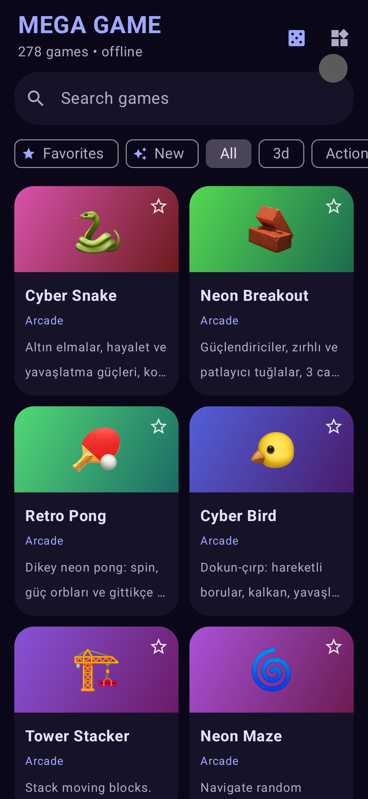
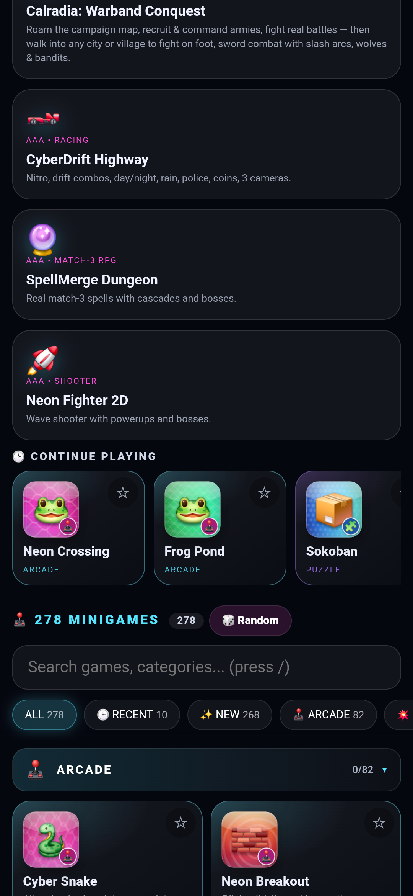
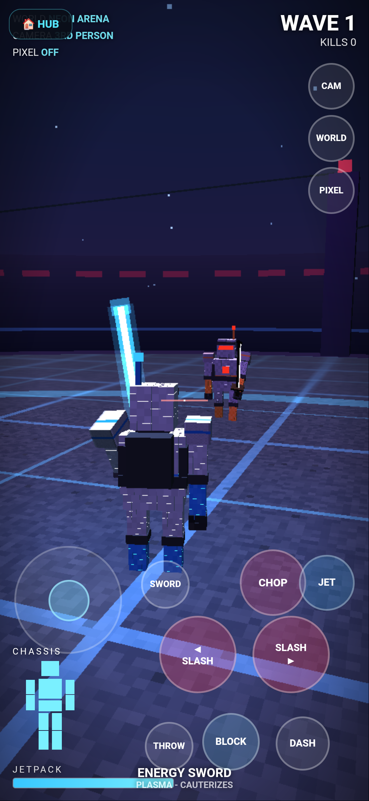
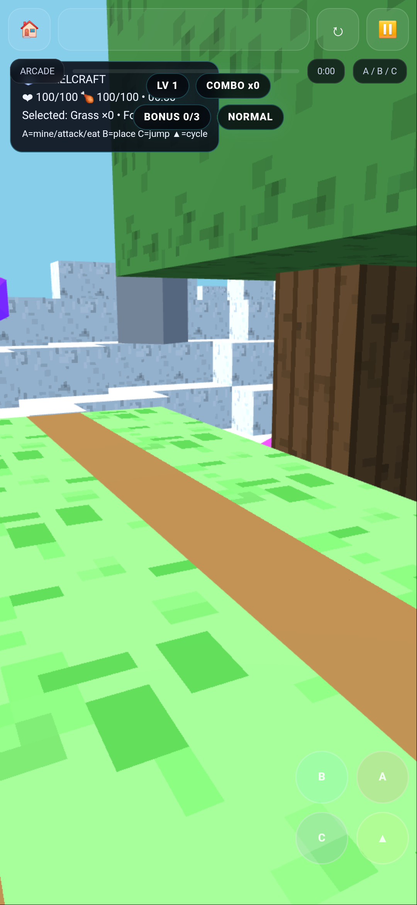

# Mega Games

**Dozens of mini games in one app.**

Mega Games bundles a few hundred small games into a single Android app, so you don't have to install a new one every time you want something different to play. Pick one from the hub and you're in. Favourites are saved, and everything works offline: the app doesn't even ask for internet access.

<p>
  
  
  
  
</p>

## What's in it

- A handful of bigger games: sword arena, space explorer, voxel survival, an open-world campaign, a racer, match-3 spells, a space shooter, Horde Survivors and Bastion Defense (tower defense).
- Around 280 minigames, from arcade to puzzle to strategy.
- Favourites, a "continue playing" row and search.

## How it works

The games are written in HTML, JavaScript and three.js. The app shows them in a WebView, with a native hub on top that lists the games and remembers your favourites. The hub is built with Jetpack Compose and Material You.

## Building

Needs Android 8.0 (API 26) or newer.

```sh
gradle assembleRelease
```

The APK ends up in `app/build/outputs/apk/release/`.

## Credits

The 3D emoji pictures in the hub are from [Microsoft's Fluent Emoji](https://github.com/microsoft/fluentui-emoji) (MIT license).

## Developer

xUmutKx
